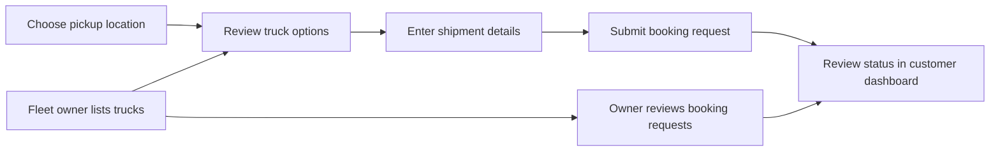

# TruckLink Logistics

TruckLink is a logistics booking experience for customers and fleet owners. Customers can plan a shipment, review truck options, and track booking status. Fleet owners can list trucks, manage availability, and respond to booking requests.

> **Demo and data note:** some truck listings, prices, ratings, and verification labels in the interface are sample data. They are not proof of a live provider check or a confirmed service. Confirm availability and final terms with the provider before arranging a real shipment.

## At a glance

| Area | What it includes |
| --- | --- |
| Customer experience | Pickup planning, truck discovery, booking requests, shipment status, and profile |
| Fleet owner experience | Fleet listings, availability, booking management, and earnings overview |
| Accessibility and preferences | Responsive layouts, English/Hindi controls, light/dark themes, reduced-motion support |
| Application stack | React, Vite, Express, MongoDB/Mongoose |
| Deployment configuration | Netlify frontend and Render API templates |

## How the booking flow works



## Project layout

```text
.
├── backend/
│   ├── middleware/       # Authentication and access control
│   ├── models/           # MongoDB models
│   ├── routes/           # Auth, customer, owner, and logistics APIs
│   └── server.js         # Express entry point and health endpoint
├── docs/
│   └── presentations/    # Stakeholder presentation materials
├── public/
│   └── landing-pages/    # Static landing-page resources
├── src/
│   ├── assets/media/     # Intro video and audio
│   ├── pages/            # Route-level page modules, including dashboards
│   ├── App.jsx           # Route selection and shared experience
│   ├── api.js            # Frontend API client
│   ├── styles.css        # Global and responsive styles
│   └── translations.js   # English and Hindi copy
├── netlify.toml          # Frontend build and SPA routing
└── render.yaml           # Backend service template
```

Presentation material: [TruckLink stakeholder script](docs/presentations/TruckLink_Logistics_Presentation_Script.docx).

## Performance and mobile experience

| Improvement | Result |
| --- | --- |
| Dashboard code splitting | Owner/customer dashboard code loads only when one of those routes is opened |
| Phone and reduced-motion intro | The large intro video is not mounted on narrow screens, reduced-motion settings, or data-saving connections |
| Deferred audio | Intro audio is not preloaded and plays only after the visitor enables sound |
| Touch and safe-area support | Mobile controls have comfortable touch targets and the floating assistant respects device safe areas |
| Responsive content | Navigation, booking steps, maps, cards, and dashboards adapt to narrow screens |

## Requirements

- Node.js 20 LTS or newer
- npm
- MongoDB for API-backed accounts, fleet, and booking data

The frontend can be explored without the API, but account actions and live dashboard/truck data require a running backend connected to MongoDB.

## Run locally

1. Install frontend dependencies from the repository root:

   ```bash
   npm install
   ```

2. Install backend dependencies:

   ```bash
   npm --prefix backend install
   ```

3. Create local environment files:

   ```bash
   # macOS/Linux
   cp .env.example .env
   cp backend/.env.example backend/.env
   ```

   On Windows PowerShell:

   ```powershell
   Copy-Item .env.example .env
   Copy-Item backend/.env.example backend/.env
   ```

4. Set `MONGODB_URI` and a unique `JWT_SECRET` in `backend/.env`. The API will not start until MongoDB is configured and reachable.

5. Start the frontend:

   ```bash
   npm run dev
   ```

6. In a second terminal, start the backend:

   ```bash
   npm run api
   ```

   To browse the frontend without live API data, start only the frontend. API-dependent features will remain unavailable.

| Service | Local address |
| --- | --- |
| Frontend | <http://127.0.0.1:5173> |
| Backend health | <http://127.0.0.1:5000/health> |
| Backend API | <http://127.0.0.1:5000/api> |

## Configuration

### Frontend (`.env`)

| Variable | Purpose | Example |
| --- | --- | --- |
| `VITE_API_BASE_URL` | Base URL for the backend API | `http://localhost:5000/api` |

The interactive map currently uses Leaflet and OpenStreetMap tiles and does not need a maps API key. Vite exposes variables prefixed with `VITE_` to browser code; never put credentials or private server secrets in frontend variables.

### Backend (`backend/.env`)

| Variable | Purpose |
| --- | --- |
| `PORT` | API listening port (local default: `5000`) |
| `NODE_ENV` | `development` locally; `production` when deployed |
| `MONGODB_URI` | MongoDB connection string |
| `JWT_SECRET` | Long, unique secret used to sign access tokens |
| `ALLOWED_ORIGINS` | Comma-separated exact frontend origins permitted by CORS |
| `SMTP_HOST`, `SMTP_PORT`, `SMTP_USER`, `SMTP_PASS`, `SMTP_FROM` | Optional outbound email configuration |

Keep `.env` files out of version control. Use a secret manager or the hosting provider's environment settings for production values. Do not use placeholder secrets, expose database credentials, or open database network access to the entire internet.

## Useful commands

| Command | Description |
| --- | --- |
| `npm run dev` | Start the Vite development server |
| `npm run build` | Create the production frontend build in `dist/` |
| `npm run preview` | Preview the production frontend build locally |
| `npm run api` | Start the backend in development mode |
| `npm --prefix backend run seed` | Seed the configured database with sample truck data |

## Deployment

### Frontend on Netlify

The repository includes `netlify.toml`.

- Build command: `npm run build`
- Publish directory: `dist`
- Set `VITE_API_BASE_URL` to the deployed backend's `/api` URL.
- Configure the exact public frontend origin in the backend's `ALLOWED_ORIGINS`.

### Backend on Render

The repository includes `render.yaml`.

- Root directory: `backend`
- Build command: `npm install`
- Start command: `npm start`
- Health check path: `/health`
- Configure `MONGODB_URI`, `JWT_SECRET`, `ALLOWED_ORIGINS`, and any email settings as Render environment variables.

Use an exact, comma-separated CORS origin list (for example, your Netlify site origin). Production cross-origin requests are blocked when `ALLOWED_ORIGINS` is missing. Never use a wildcard CORS policy or expose MongoDB to `0.0.0.0/0` as a quick fix.

### Recommended release checks

1. Confirm MongoDB connectivity and a successful `/health` response.
2. Confirm the frontend API URL and backend CORS origin match the deployed domains.
3. Verify customer and owner registration/login, including authenticator setup.
4. Verify truck search, booking requests, status updates, and dashboard access.
5. Check the main flows at a narrow mobile viewport as well as desktop.

## Security and product boundaries

- Customer and fleet-owner accounts use role-based access.
- The backend implements password hashing and authenticator-based MFA flows; do not describe this as an independent security audit or a guarantee of safety.
- Displayed sample listings and verification indicators are illustrative unless independently confirmed.
- A submitted booking request is not a confirmed shipment until the relevant status is updated.

## Current state

- Production frontend build: `npm run build`
- Browser app routes use hash-based navigation.
- TruckMate is a page-aware, rule-based guide; it does not call a generative AI service.
- The backend is a separate service and must be configured for live API-backed features.
